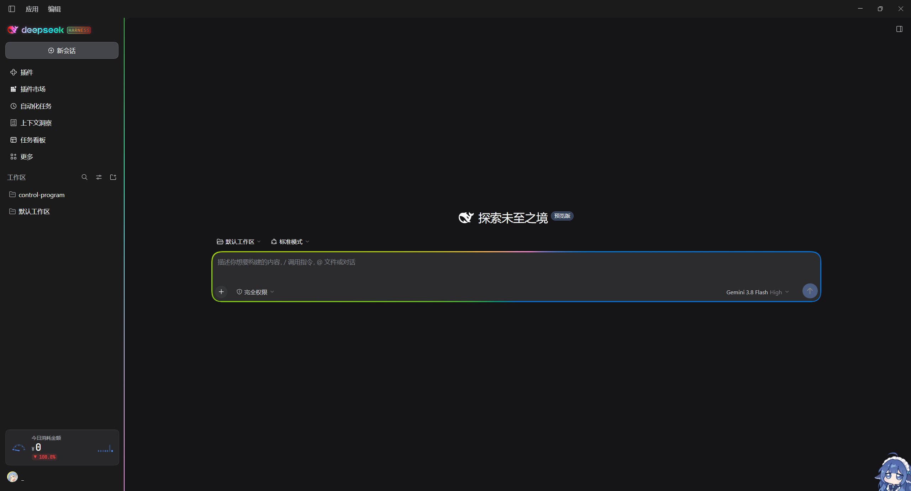

# dsh-rgb



为 DeepSeek Harness 提供 RGB 灯光效果。

包含四个模块：输入框光环、侧边栏光条、活动会话指示器、品牌 Logo 发光。

## 功能

### 输入框光环
环绕输入框的渐变边框，适配圆角。提供 6 种模式：静态渐变、光谱循环、呼吸、呼吸流动、流动跑马灯、雷达扫描。

光环会随会话状态变化：推理中流速加快，待命时显示柔和琥珀色，出错时变为红色。输入框获得焦点时亮度提升。

### 侧边栏光条
贴合侧边栏右边缘的垂直光柱，可单独开关，支持流动、呼吸、静态三种模式。

### 活动会话指示器
自动定位当前活跃的会话条目，在左侧显示一个垂直流动的呼吸胶囊。

### 品牌 Logo 发光
通过 DeepSeek Harness 的 `sidebar.brand.mark` 和 `sidebar.brand.name` 插槽，替换小鲸鱼图标和品牌字标。使用 SVG 矢量路径，避免背景色差和边缘色块。深色主题下柔和发光，浅色主题下自动加深描边阴影。

### 设置面板
内置于 Harness 原生设置界面（RGB Composer Ring），可调节：速度（0–20 秒）、亮度（20%–100%）、描边粗细（1–5px）、外扩间距（-4–8px）、顺/逆时针方向。

配色方案包括：彩虹、极光、霓虹、日落、单色，以及支持 2–6 色的自定义调色板。

## 安装

克隆仓库到 Harness 工作区或指定目录：

```bash
git clone https://github.com/MarushiruDonato/dsh-rgb.git
```

在 Harness 配置文件中引入插件，或通过软链接挂载到 `~/.dsh/profiles/<profile>/node_modules/@local/rgb-composer-ring`。

刷新 Harness 界面（`Ctrl + R`）即可生效。

## 主要文件

```text
dsh-rgb/
├── locale/            # 国际化文案
├── client.js          # 客户端逻辑
├── index.js           # 入口
├── cordis.patch.yml   # Cordis 补丁配置
├── icon.svg           # 图标
├── angleAt.test.mjs   # 角度计算测试
└── package.json
```

## 许可证

[MIT License](LICENSE)。
